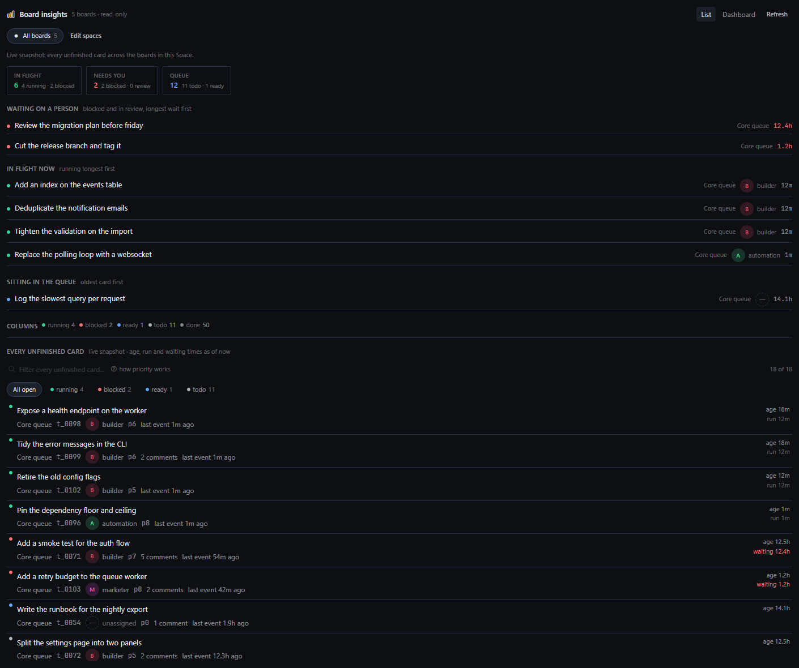
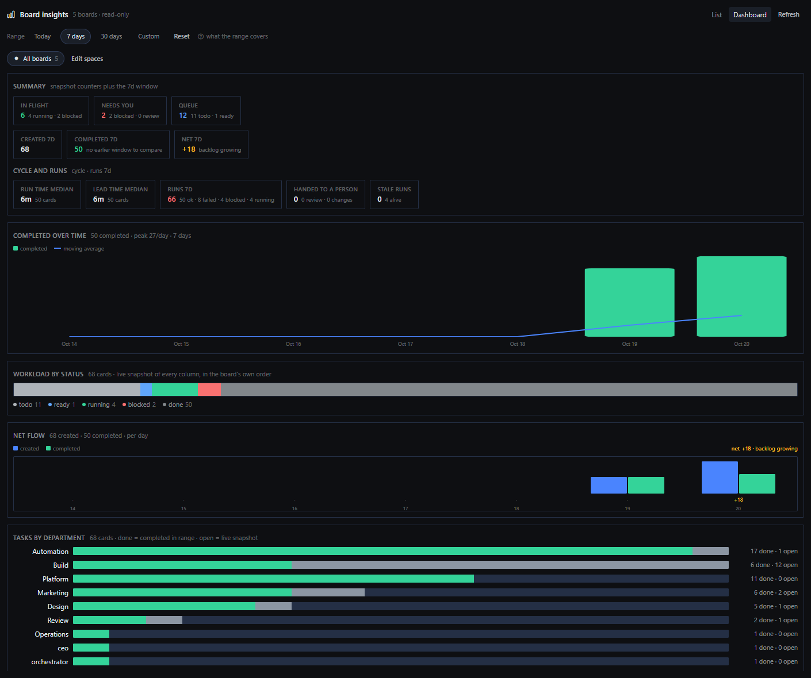

# Board insights

A read-only analytics page for the Hermes Kanban boards, in the Hermes desktop app.

The board shows you the cards. This shows you the flow: what is in flight right now, what is
waiting on a person rather than on compute, whether throughput is rising or dipping over the
last 3 to 90 days, how long a run really takes, and every unfinished card across every board
in one filterable list.





## What it does

| View | Answers |
|---|---|
| **List** | In flight, needs you, queue. The card waiting longest, the cards running now, what is sitting in the queue, the columns, and every unfinished card across every board with a filter box and status chips. Live snapshot. |
| **Dashboard** | Summary counters, completed over time with a moving average, workload by status, net flow (created minus completed), tasks by department, created vs completed, cycle and run medians, stale runs, and a per-assignee table. Driven by one date range: today, 7, 30 or custom (up to 90 days). |

- **Spaces**: a named set of boards, saved in the plugin's own storage, so the page can read
  one project or every board. It ships with a single `All boards` Space and creates nothing
  on your install. Make your own from **Edit spaces**.
- **Per-person chips**: the profile's own stored avatar when there is one, else its initial in
  the app's own identity colour. No stock faces.
- **Read-only by construction**: every `kanban.db` is opened with SQLite `mode=ro`. There is no
  write path, no tool, no hook, no model call and nothing to configure.

## Install

```bash
hermes plugins install kwpings/board-insights
hermes plugins enable board-insights
```

Then two gates, both deliberate:

1. **A plugin installs disabled.** `hermes plugins enable board-insights` is the second command.
   Without it the backend is never imported.
2. **The desktop half is opt-in.** Open **Settings -> Plugins -> Board insights** and turn the
   desktop page on. It then appears as **Board insights** in the sidebar.

If the page is missing entirely, gate 2 is the reason. If the page loads but shows an error,
the backend half is not enabled (gate 1) or there is no readable kanban store yet.

## What it reads

The Kanban store on this machine, resolved in this order: `HERMES_KANBAN_HOME`,
`HERMES_KANBAN_DIR`, `<HERMES_HOME>/kanban`, the local app-data kanban folder, then
`~/.hermes/kanban`. Every board directory holding a `kanban.db` is picked up. No boards yet?
The page says so once instead of drawing zeroes.

## Disclosure

- Opens `kanban.db` files **read-only** (`mode=ro`); no statement in this plugin writes.
- Stores two things in the plugin's own storage: your Spaces and your date range. Nothing else.
- No network calls, no model calls, no credentials, no background processes, no telemetry.

## Requirements

- Hermes Agent `>=0.22.0`, desktop app.
- The empty-state, `List`/`Dashboard` split and every tile are desktop-only; there is no web
  dashboard or TUI half.

## Verify it yourself

```bash
hermes plugins validate /path/to/board-insights     # the same gate catalog CI runs
```

`verify/` holds the harness this page was built against: `shot.py` renders the real page from
the real `plugin.js` under the app's own vitest + stylesheet and screenshots it, and
`fixtures/` are recorded API payloads. Nothing in `verify/` ships to a user; it is excluded
from the plugin's runtime.

## License

MIT - see [LICENSE](LICENSE).
